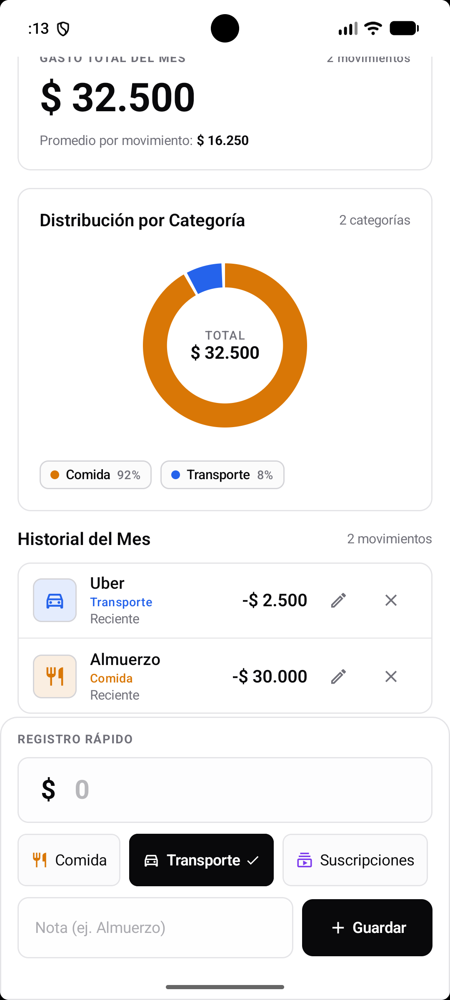
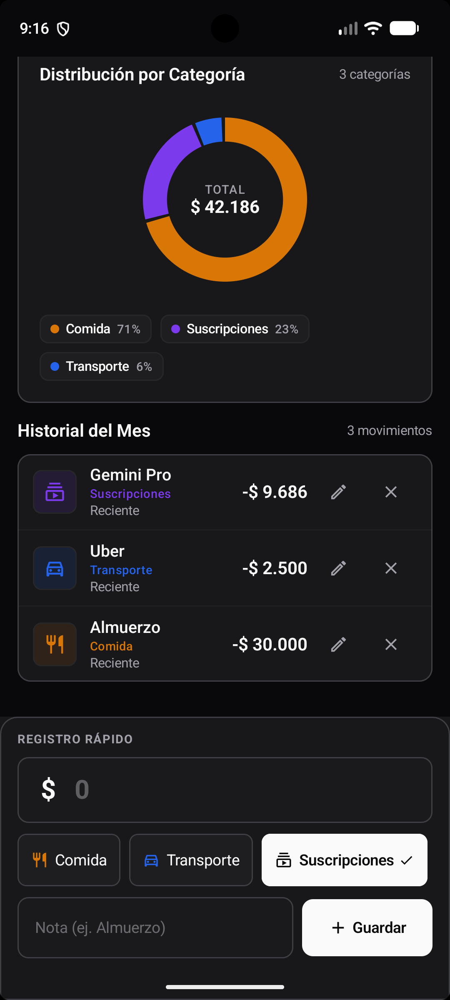
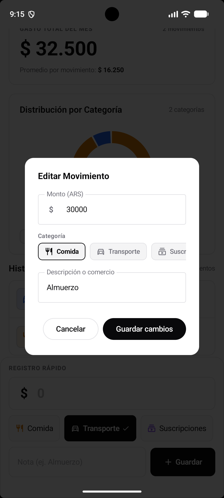
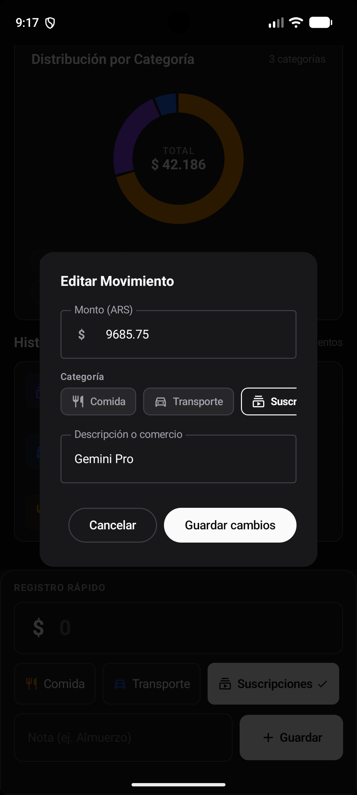
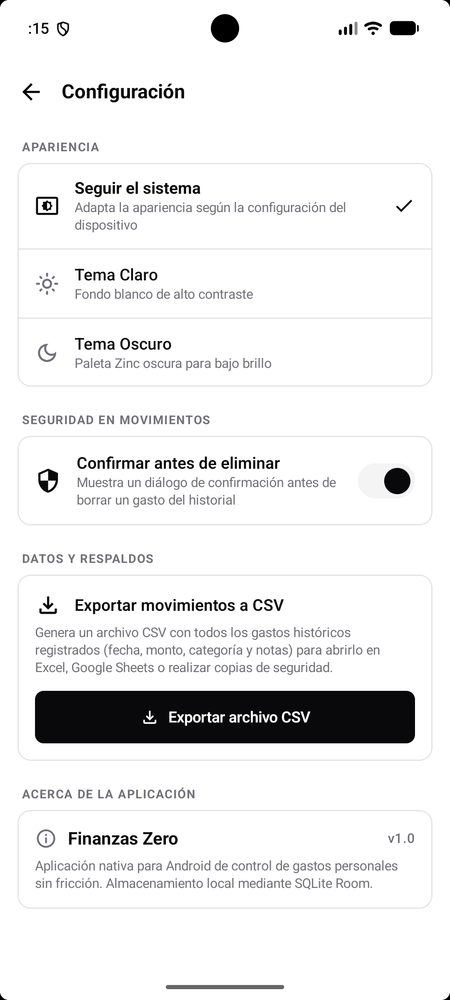
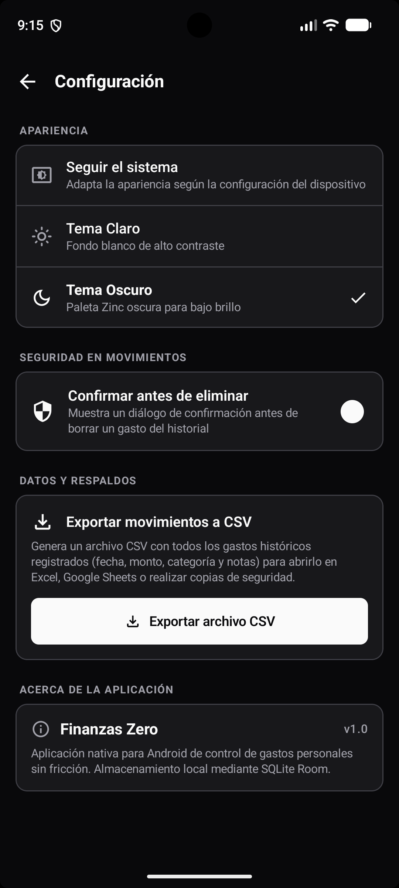

# 💸 Finanzas Zero — Showcase

<p align="center">
  <strong>Control de gastos personales con selector mensual y exportación de informes PDF, optimizado para Argentina.</strong><br>
  Una experiencia móvil nativa, rápida y minimalista construida con Kotlin, Jetpack Compose y Room SQLite.
</p>

<p align="center">
  
  
  
  
  
  
  
  
</p>

---

## 📌 Descripción del Proyecto

**Finanzas Zero** es una aplicación móvil nativa para Android diseñada para resolver la fricción cotidiana al registrar, categorizar y analizar gastos personales en pesos argentinos (ARS).

El proyecto adopta una filosofía de diseño rigurosamente minimalista (*anti-slop*): interfaces monocromáticas de alto contraste basadas en la paleta Zinc, sin gradientes recargados ni artificios visuales, priorizando la velocidad operativa, la respuesta inmediata al toque y la claridad informativa.

La persistencia de los registros es completamente local mediante una base de datos SQLite administrada por Room. La aplicación cuenta con navegación temporal por meses históricos, panel de configuración personalizable (temas visuales, confirmación de borrado, exportación de informes PDF profesionales) y un panel inferior permanente para registrar gastos manuales en tres pasos.

---

## ✨ Funcionalidades Principales

- **Selector Mensual Dinámico:** Consulta interactiva del mes actual y meses históricos anteriores mediante controles accesibles, recalculando al instante métricas, promedios y gráficos.
- **Dashboard Financiero del Mes:** Visualización instantánea del gasto total acumulado en el mes seleccionado, cantidad de movimientos y promedio por operación.
- **Gráfico de Dona Interactivo:** Análisis visual de la distribución del gasto por categorías mediante Compose Canvas, con cálculo automático de porcentajes y cantidades según el mes activo.
- **Registro Rápido sin Fricción:** Entrada manual con teclado numérico optimizado, chips de categoría con objetivo táctil accesible y notas descriptivas opcionales.
- **Historial Completo con Edición y Eliminación:** Listado cronológico de movimientos filtrados por mes, con soporte para modificar importes, categorías o notas mediante diálogos modales.
- **Exportación de Informes en PDF:** Generación de resúmenes formales en formato PDF estándar A4 con métricas clave, desglose por categoría y detalle de transacciones con paginación automática mediante el Storage Access Framework.
- **Pantalla de Configuración:** Gestión de apariencia (Sistema, Claro, Oscuro), confirmación antes de eliminar gastos, exportación general de datos a PDF e información de versión.
- **Persistencia Confiable:** Almacenamiento local directo en SQLite con Android Room 2.7.0.

---

## 🔒 Privacidad y Flujo de Datos

- **Almacenamiento Local de Transacciones:** Todos los gastos, montos, notas, fechas y categorías residen exclusivamente en la base de datos local SQLite del dispositivo.
- **Operación 100% Offline:** La aplicación no realiza llamadas de red, no utiliza servicios en la nube ni requiere conexión a internet para ninguna de sus funciones.
- **Cero Permisos Sensibles:** No solicita permisos de micrófono, cámara, ubicación ni acceso a almacenamiento compartido en tiempo de ejecución.
- **Exportación Segura mediante SAF:** La exportación a PDF delega la creación del archivo directamente al usuario a través del **Storage Access Framework** (`ACTION_CREATE_DOCUMENT`), permitiendo elegir el destino (almacenamiento local o en la nube) sin solicitar permisos generales de escritura en disco (`WRITE_EXTERNAL_STORAGE`).

---

## 📅 Selector Mensual y Filtrado Temporal

El dashboard incluye un selector de mes en su cabecera:
- **Visualización en español:** Muestra el mes y año en curso (ej. *Octubre 2026*).
- **Navegación histórica:** Permite retroceder a cualquier mes anterior con registros o meses intermedios.
- **Límite al presente:** La navegación hacia meses futuros se encuentra deshabilitada para evitar selecciones inconsistentes.
- **Retorno rápido:** Botón accesible para regresar en un toque al mes actual desde cualquier período histórico.
- **Sincronización al registrar:** Si el usuario consulta un mes pasado y carga un nuevo gasto, la aplicación lo guarda con su fecha y hora real y reubica automáticamente la vista en el mes actual para verificar el movimiento de inmediato.
- **Meses sin movimientos:** Muestra valores en cero y un mensaje explicativo claro: *«No hay gastos registrados en este mes»*.

---

## ✍️ Registro de Gastos: Entrada Manual Rápida

- **Teclado numérico decimal:** Directo y sin intermediarios, con validación inmediata de importes mayores a cero.
- **Selector horizontal de categorías:** Toque único con iconos semánticos de Material 3 y área táctil mínima de 48 dp.
- **Campo de notas opcional:** Espacio para detallar el comercio o concepto (ej. *Almuerzo*, *Supermercado*).
- **Guardado en un solo paso:** Disponible permanentemente en la parte inferior de la pantalla principal (`QuickEntryDrawer`), actualizando las métricas al instante.

---

## 📄 Exportación de Informes en PDF

Finanzas Zero incorpora un generador nativo de reportes en formato PDF estándar A4 (`595 x 842 pt`), diseñado para imprimir, archivar o compartir resúmenes financieros sin dependencias de servicios externos:

- **Encabezado institucional:** Título formal, fecha de emisión y rango temporal evaluado.
- **Resumen ejecutivo:** Tarjeta con cuatro métricas consolidadas: total gastado en ARS, cantidad de transacciones, promedio por operación y categoría con mayor impacto presupuestario.
- **Desglose analítico por categoría:** Tabla estructurada con el gasto total y porcentaje de incidencia para cada uno de los 6 rubros.
- **Detalle de movimientos y paginación continua:** Listado de transacciones con fecha, descripción, categoría y monto formateado en moneda local. Incluye cálculo dinámico de capacidad por página para evitar cortes abruptos y truncamiento elíptico seguro (`…`) para notas extensas.
- **Integración con Storage Access Framework (SAF):** Permite al usuario guardar el archivo con nombre sugerido `finanzas-zero-resumen-YYYY-MM-DD.pdf` en cualquier carpeta local o proveedor de almacenamiento en la nube.

---

## ⚙️ Pantalla de Configuración

Accesible mediante el ícono de engranaje en la cabecera:
1. **Apariencia / Tema:**
   - *Seguir el sistema*: se adapta dinámicamente a la preferencia de Android.
   - *Tema Claro*: interfaz de alto contraste sobre fondo blanco.
   - *Tema Oscuro*: paleta Zinc oscura para confort visual en baja luz.
   - La selección se aplica de inmediato y se conserva entre sesiones mediante `SharedPreferences`.
2. **Confirmar antes de eliminar:**
   - Interruptor configurable (activado por defecto) que previene borrados accidentales mostrando un diálogo de confirmación con los detalles del movimiento.
3. **Exportar resumen PDF:**
   - Dispara el selector nativo de documentos de Android (`CreateDocument`) para generar y persistir el informe PDF estructurado de manera instantánea.
4. **Acerca de la app:**
   - Muestra la versión real del proyecto (`1.0.0-beta.1`) obtenida directamente de la configuración de compilación.

---

## 📊 Dashboard y Gráficos

El panel principal organiza la información con jerarquía estricta:
1. **Tarjeta de Impacto (Total del Mes):** Suma total de los gastos del mes seleccionado, conteo de movimientos y promedio monetario por operación.
2. **Distribución por Categorías:** Gráfico de anillo (*donut chart*) renderizado con Jetpack Compose Canvas con microanimaciones, complementado por insignias de porcentaje y totales por rubro:
   - 🍽️ **Comida:** Alimentos, restaurantes y delivery.
   - 🚗 **Transporte:** Nafta, viajes en auto, peajes y transporte público.
   - 📺 **Suscripciones:** Servicios digitales, streaming y software.
   - 🎟️ **Entretenimiento:** Cines, eventos, recitales y salidas.
   - 📈 **Finanzas:** Inversiones, cuentas y transferencias.
   - 📦 **Otros:** Compras generales e indumentaria.
3. **Historial de Movimientos:** Lista cronológica del mes seleccionado con fechas relativas (*Hoy*, *Ayer*) y accesos directos de edición y borrado.

---

## 🏷️ Versionado Semántico y Estado del Proyecto

Finanzas Zero adopta la especificación de **Versionado Semántico (SemVer)**: `MAJOR.MINOR.PATCH`, complementado con etiquetas para versiones preliminares:

- **Versión actual:** `1.0.0-beta.1`
- **Código de versión:** `versionCode = 2`
- **Estado de desarrollo:** **Fase Beta** — Funcionalidades troncales completas, interfaz validada en dispositivos emulados y suite de pruebas unitarias automatizadas (15/15 pruebas aprobadas).

---

## 🛠️ Tecnologías Utilizadas

- **Lenguaje:** Kotlin (100%).
- **UI:** Jetpack Compose con Material Design 3 (M3) y paleta Zinc monocromática.
- **Arquitectura:** MVVM (Model-View-ViewModel) con Clean Repository Pattern.
- **Programación Asincrónica:** Kotlin Coroutines y StateFlow reactivo.
- **Persistencia Local:** Android Room Database (2.7.0) con SQLite y consultas reactivas Flow.
- **Generación de Documentos:** `android.graphics.pdf.PdfDocument` nativo de Android.
- **Integración con el Sistema:** Storage Access Framework (`ActivityResultContracts.CreateDocument`).
- **Persistencia de Preferencias:** SharedPreferences de Android para configuración de usuario.
- **Compilación y Optimizaciones:** Gradle (Kotlin DSL), KSP (Kotlin Symbol Processing), AGP 9 y R8/ProGuard optimizado.

---

## 🏗️ Arquitectura del Sistema

```
┌─────────────────────────────────────────────────────────────────┐
│                     Capa de Interfaz (UI)                       │
│  FinanceDashboardScreen ── SettingsScreen ── DonutChart Canvas │
└────────────────────────────────┬────────────────────────────────┘
                                 │ Eventos / StateFlow
                                 ▼
┌─────────────────────────────────────────────────────────────────┐
│                    Capa de Lógica (ViewModel)                   │
│                     FinanceViewModel                            │
│    (Selector mensual, estado de edición, flujos reactivos)      │
└───────────────┬─────────────────────────────────┬───────────────┘
                │                                 │
                ▼                                 ▼
┌─────────────────────────┐             ┌───────────────────┐
│ Capa de Datos y Dominio │             │ Capa Preferencias │
│    FinanceRepository    │             │   UserPrefsRepo   │
│            │            │             │  (SharedPrefs)    │
│            ▼            │             └───────────────────┘
│       ExpenseDao        │
│     & PdfExporter       │
│            │            │
│            ▼            │
│ Base de Datos Room      │
│        (SQLite)         │
└─────────────────────────┘
```

---

## 📸 Capturas de Pantalla

### 1. Dashboard Principal y Registro Rápido
Resumen mensual consolidado (gasto total en ARS, cantidad de movimientos y promedio por operación), selector dinámico de mes con navegación histórica, gráfico de dona interactivo por categorías (`CategoryDonutChart`) y panel inferior permanente `QuickEntryDrawer` para la carga rápida de gastos con chips táctiles y teclado decimal optimizado.

<table align="center">
  <thead>
    <tr>
      <th align="center">Modo Claro</th>
      <th align="center">Modo Oscuro</th>
    </tr>
  </thead>
  <tbody>
    <tr>
      <td align="center">
        
      </td>
      <td align="center">
        
      </td>
    </tr>
  </tbody>
</table>

### 2. Diálogo de Edición de Registro
Diálogo modal reactivo accesible desde cualquier movimiento del historial mensual, permitiendo corregir el importe, cambiar la categoría semántica o actualizar notas descriptivas en tiempo real.

<table align="center">
  <thead>
    <tr>
      <th align="center">Modo Claro</th>
      <th align="center">Modo Oscuro</th>
    </tr>
  </thead>
  <tbody>
    <tr>
      <td align="center">
        
      </td>
      <td align="center">
        
      </td>
    </tr>
  </tbody>
</table>

### 3. Pantalla de Configuración y Preferencias
Panel de ajustes de la aplicación: selector de tema visual (Sistema, Claro, Oscuro) con guardado persistente en `SharedPreferences`, interruptor de confirmación previa para eliminación de gastos, exportación a informe PDF profesional A4 mediante selector nativo de documentos e información de versión de compilación (`1.0.0-beta.1`).

<table align="center">
  <thead>
    <tr>
      <th align="center">Modo Claro</th>
      <th align="center">Modo Oscuro</th>
    </tr>
  </thead>
  <tbody>
    <tr>
      <td align="center">
        
      </td>
      <td align="center">
        
      </td>
    </tr>
  </tbody>
</table>

---

## ⚖️ Derechos de Autor y Licencia

© 2026 Tomás Moroz. Todos los derechos reservados.
