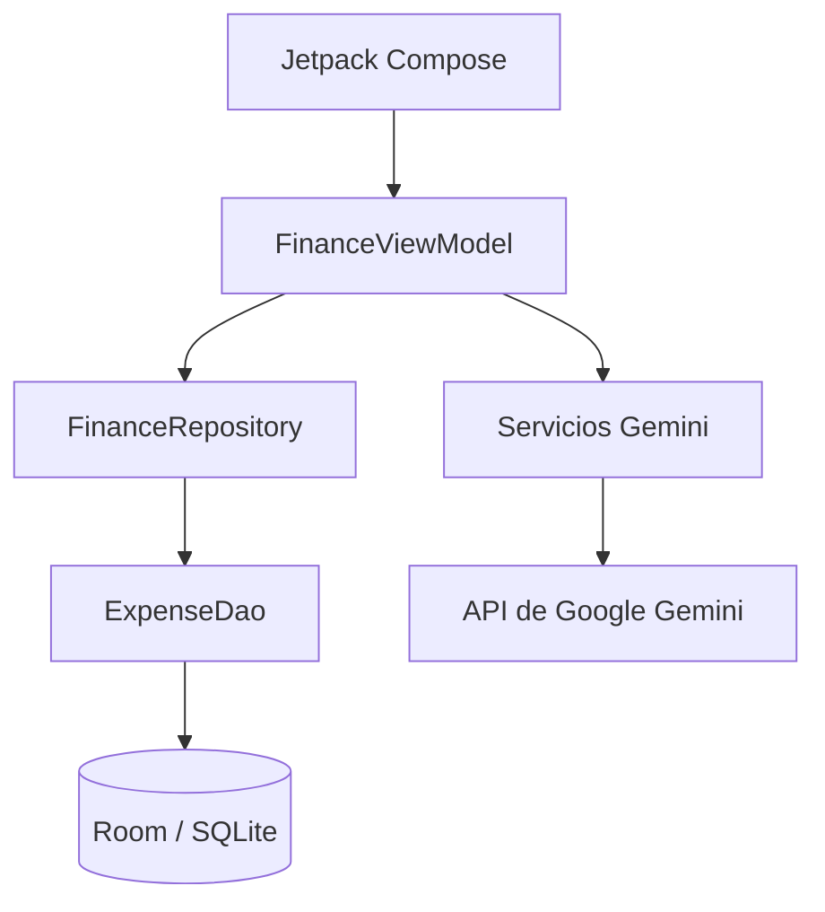

# 💸 Finanzas Zero

**Control de gastos personales con IA y voz, pensado para Argentina.**

Finanzas Zero es una aplicación nativa para Android que combina una interfaz minimalista, almacenamiento local de gastos y funciones de inteligencia artificial para registrar movimientos y consultar resúmenes mediante texto o voz.

> Este repositorio es una presentación pública del proyecto. No contiene el código fuente ni ofrece una descarga del APK.

## Funcionalidades

- Dashboard con el total de gastos registrados y distribución por categoría.
- Gráfico de dona para comparar categorías.
- Registro manual con monto, categoría y nota.
- Historial de movimientos con edición y eliminación.
- Registro por voz con interpretación del importe, concepto y categoría.
- Asistente financiero con consultas en lenguaje natural.
- Modo manos libres con respuestas habladas en español rioplatense.
- Catálogo contextual de comercios y conceptos habituales en Argentina.

## Capturas de pantalla

Las capturas reales se agregarán próximamente:
- Dashboard y gráfico por categorías.
- Registro manual de gastos.
- Asistente financiero y modo por voz.

## Arquitectura general

## Tecnologías

| Área | Tecnología |
|---|---|
| Lenguaje | Kotlin |
| Interfaz | Jetpack Compose y Material 3 |
| Estado y asincronía | ViewModel, Coroutines y Flow |
| Persistencia local | Room y SQLite |
| IA | Google Gemini API |
| Audio | APIs nativas de Android y Gemini TTS |
| Red | OkHttp |
| Construcción | Gradle Kotlin DSL y KSP |

## Privacidad y flujo de datos

Los movimientos de gastos se guardan localmente en el dispositivo mediante Room/SQLite. La aplicación no sincroniza esa base de datos con un backend multiusuario.

Al usar las funciones de IA, se transmiten fragmentos de audio y contexto financiero —por ejemplo, totales, desglose por categoría y movimientos recientes— a Google Gemini mediante HTTPS para su procesamiento. Tené en cuenta este flujo antes de usar información financiera sensible.

## Objetivo

El proyecto explora cómo combinar una experiencia Android nativa, persistencia local e IA multimodal para simplificar tareas cotidianas como registrar gastos y consultar un resumen financiero.

## Derechos de autor

© 2026 Tomás Moroz. Todos los derechos reservados.

Este repositorio presenta el proyecto y no concede por medio de este README una licencia para copiar, redistribuir o explotar comercialmente la aplicación.
